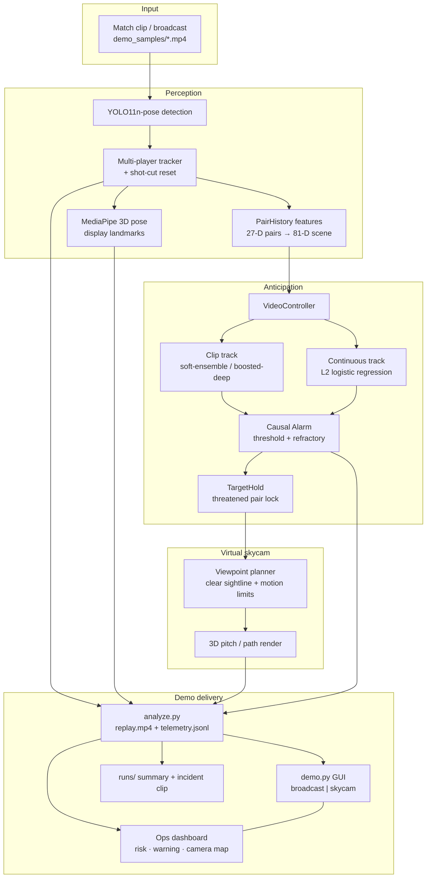
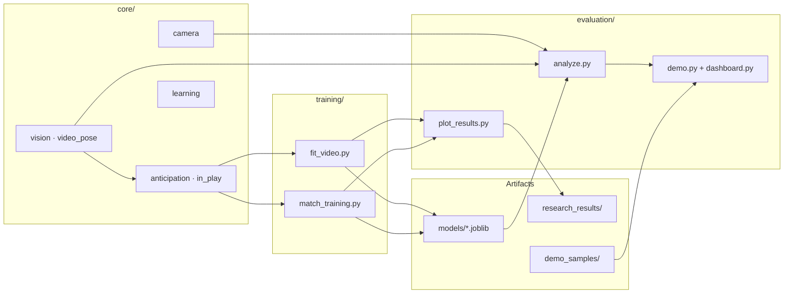
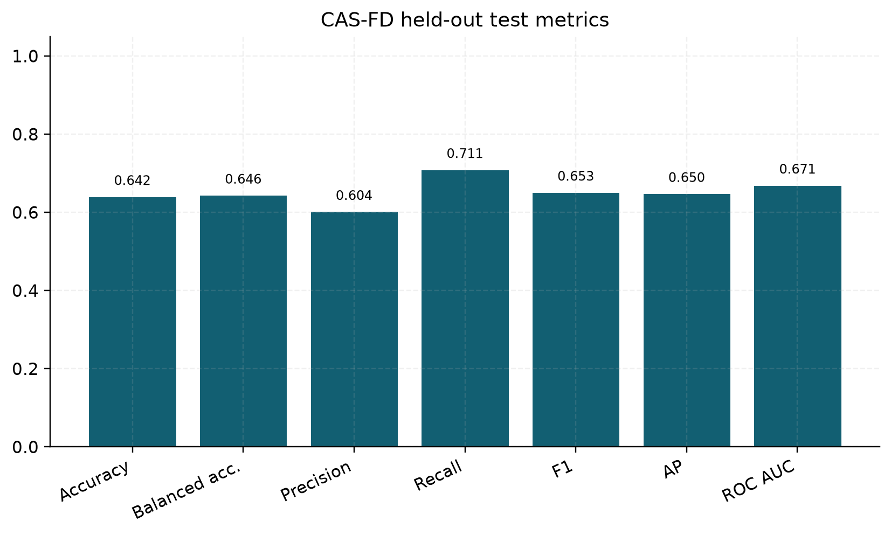
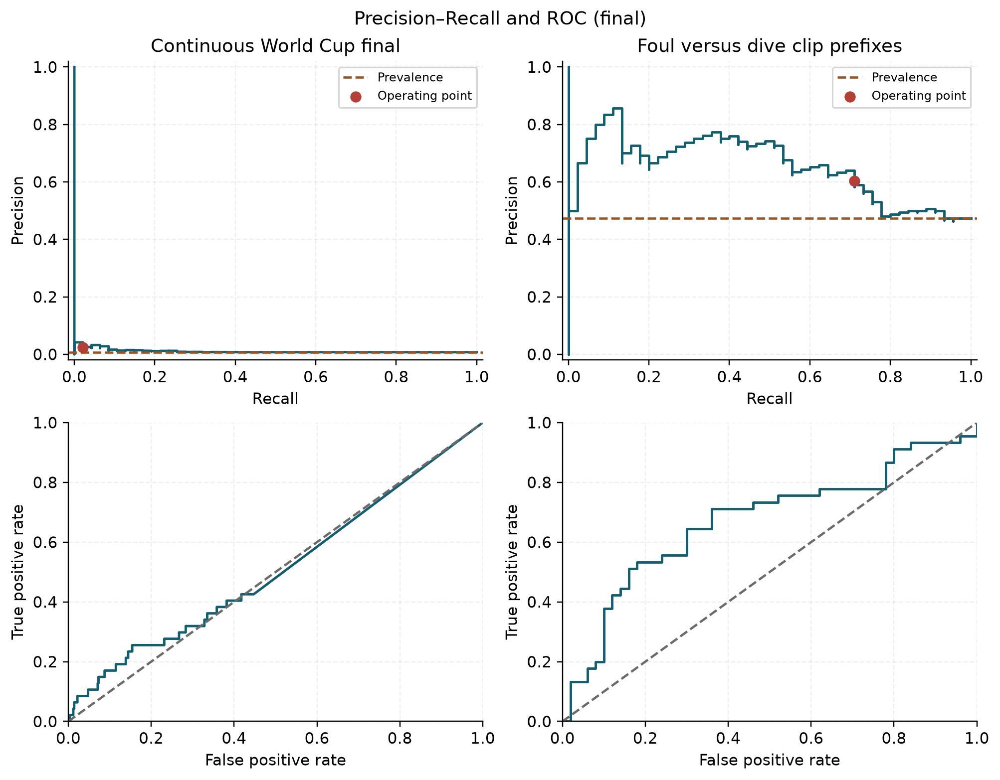
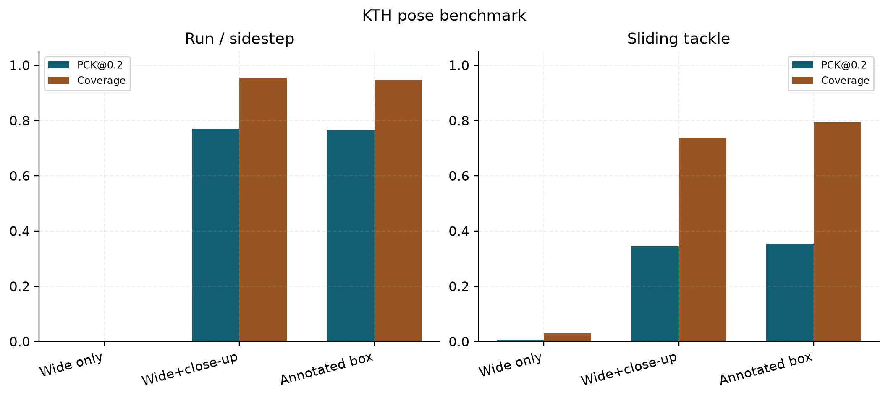
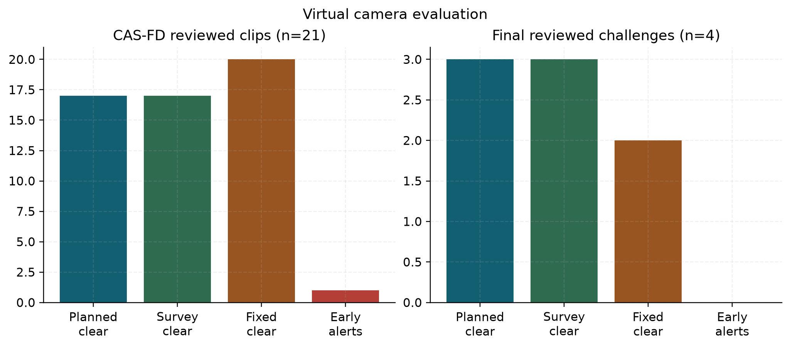

# Forensic Sky-Robotics

**Computer Vision (23AID301) — End Semester Project**

Pose- and motion-based football challenge analysis: classify foul vs dive interactions from short clips, forecast foul risk on continuous broadcast halves, and drive a simulated aerial camera toward the threatened player pair — with a live ops dashboard in the desktop demo.

| | |
|---|---|
| **Primary result** | CAS-FD foul-vs-dive (held-out test) — final soft-ensemble |
| **Final accuracy** | **64.2%** |
| **Final F1** | **65.3%** |
| **Final ROC AUC** | **67.1%** |
| **Report** | [`report.md`](report.md) |
| **Plots** | [`research_results/plots/`](research_results/plots/) |
| **Demo clips** | [`demo_samples/`](demo_samples/) (5 videos included) |

> Full training `datasets/` are **not** shipped (see [`datasets/README.md`](datasets/README.md)). Code, frozen models, prepared caches, locked metrics, and **five demo videos** are included so a fresh clone can run the GUI immediately.

---

## 1. Highlights

- Desktop demo with **broadcast + virtual skycam** replay and a **real-time ops dashboard**
- Soft elevated-risk → hard **FOUL ANTICIPATED** warning, plus skycam **RELOCATING / LOCKED ON** map
- Locked two-step CAS-FD evaluation (pre-finetune → final soft-ensemble)
- Continuous World Cup half forecasting reported honestly as a hard baseline
- Pose (KTH) and camera supporting evaluations
- Metric dumps + PNG figures under `research_results/`

---

## 2. System architecture

End-to-end flow from video input through perception, anticipation, virtual camera control, and the demonstration UI.



### Module map



**Runtime idea:** perception runs causally on past frames only → a scene score is compared to a frozen threshold → on onset the threatened pair is held and the skycam relocates → every frame is logged to telemetry and mirrored on the ops HUD during live analysis and synced Replay.

Methodology detail: [`report.md`](report.md) §2.

---

## 3. Demo — clone and run

No full dataset download is required for the demonstration.

### 3.1 Prerequisites

| Requirement | Notes |
|---|---|
| Windows | GUI uses Tkinter |
| Python **3.11** | Matches frozen env / `Launch Demo.cmd` |
| Packages | See [`requirements.txt`](requirements.txt) (install into `.venv`) |
| FFmpeg | Optional — used only to export short `incident.mp4` clips |

If you use the project `.venv` on Windows with the `uv` CPython build (same pattern as development):

```powershell
cd "<project-root>"
python -m venv .venv
.\.venv\Scripts\pip install -r requirements.txt
```

### 3.2 One-click GUI

```text
Double-click  Launch Demo.cmd
```

Or PowerShell:

```powershell
cd "<project-root>"
$env:PYTHONPATH = "$PWD\.venv\Lib\site-packages"
& "$env:USERPROFILE\AppData\Roaming\uv\python\cpython-3.11-windows-x86_64-none\python.exe" demo.py
```

If that interpreter path is missing on your machine:

```powershell
$env:PYTHONPATH = "$PWD\.venv\Lib\site-packages"
python demo.py
```

### 3.3 Shipped sample clips

| Dropdown label | File | Role |
|---|---|---|
| World Cup final \| Argentina - France | [`demo_samples/world_cup_final.mp4`](demo_samples/world_cup_final.mp4) | Longer broadcast excerpt |
| CAS-FD foul \| challenge 105 | [`demo_samples/casfd_foul_105.mp4`](demo_samples/casfd_foul_105.mp4) | Foul challenge |
| CAS-FD foul \| challenge 128 | [`demo_samples/casfd_foul_128.mp4`](demo_samples/casfd_foul_128.mp4) | Foul challenge |
| CAS-FD foul \| challenge 107 | [`demo_samples/casfd_foul_107.mp4`](demo_samples/casfd_foul_107.mp4) | Foul challenge |
| CAS-FD dive \| challenge 101 | [`demo_samples/casfd_dive_101.mp4`](demo_samples/casfd_dive_101.mp4) | Dive contrast case |

Catalog notes: [`demo_samples/README.md`](demo_samples/README.md).

### 3.4 What to do in the UI

1. Open the demo (section 3.2).  
2. Pick a shipped clip from the dropdown (or **Browse MP4**).  
3. Click **Run analysis**.  
4. While it runs you should see:
   - dual pane updating (**BROADCAST** \| **VIRTUAL SKYCAM**)
   - **Ops dashboard** under the video: foul risk gauge, anticipation warning, skycam status + mini pitch path  
5. When finished, use **Replay** (frame-synced HUD) or **Open results** (`runs/<timestamp>/`).

### 3.5 What the ops dashboard shows

| Panel | Behaviour |
|---|---|
| **Foul risk** | Score vs frozen threshold → `SURVEY` / `ELEVATED` / `ANTICIPATED` |
| **Anticipation** | Soft elevated risk, then flashing **FOUL ANTICIPATED** on alarm onset/hold with target IDs |
| **Virtual skycam** | `SURVEY` → `RELOCATING` → `LOCKED ON`, with trail, current position, and destination arrow |

### 3.6 Offline CLI (no GUI)

```powershell
$env:PYTHONPATH = "$PWD\.venv\Lib\site-packages"
python analyze.py "demo_samples\world_cup_final.mp4"
```

Each run writes under `runs/`:

| Artifact | Contents |
|---|---|
| `replay.mp4` | Side-by-side broadcast + skycam panel |
| `telemetry.jsonl` | Per-frame score, alert, camera pose/destination |
| `summary.json` | Run metadata and alert counts |
| `incident.mp4` | Optional peak-window extract (needs FFmpeg) |

---

## 4. Locked results — CAS-FD foul vs dive (primary)

**Dataset:** CAS-FD · **Folder (local):** `datasets/cas_fd/`  
**Protocol:** ≥1 s prefixes · validation-only model/cutoff/threshold selection · single held-out test

### Split (retained after deduplication)

| Split | Clips | Foul | Dive |
|---|---:|---:|---:|
| Train | 351 | 151 | 200 |
| Validation | 98 | 48 | 50 |
| **Test** | **95** | **45** | **50** |
| Total retained | 544 | — | — |
| Raw on disk | 600 | — | — |

### Step 1 — pre-finetune (`boosted-deep`, cutoff 1.0 s)

| Metric | Test |
|---|---:|
| Accuracy | 63.2% |
| Balanced accuracy | 63.3% |
| Precision | 60.0% |
| Recall | 66.7% |
| F1 | 0.632 |
| Average precision (AP) | 0.638 |
| ROC AUC | 0.676 |

### Step 2 — final (`soft-ensemble`, cutoff 1.0 s) ✅

| Metric | Test |
|---|---:|
| **Accuracy** | **64.2%** |
| **Balanced accuracy** | **64.6%** |
| **Precision** | **60.4%** |
| **Recall** | **71.1%** |
| **F1** | **0.653** |
| **Average precision (AP)** | **0.650** |
| **ROC AUC** | **0.671** |

**Operating point:** threshold ≈ **0.328** · confusion (TN, FP, FN, TP) ≈ **29 / 21 / 13 / 32**




| Figure | Path |
|---|---|
| PR curve | [`research_results/plots/clip_pr.png`](research_results/plots/clip_pr.png) |
| ROC curve | [`research_results/plots/clip_roc.png`](research_results/plots/clip_roc.png) |
| Confusion matrix | [`research_results/plots/clip_confusion.png`](research_results/plots/clip_confusion.png) |
| Score distributions | [`research_results/plots/clip_scores.png`](research_results/plots/clip_scores.png) |
| Prefix sensitivity | [`research_results/plots/clip_prefix_sensitivity.png`](research_results/plots/clip_prefix_sensitivity.png) |
| Bootstrap CIs | [`research_results/plots/clip_bootstrap_ci.png`](research_results/plots/clip_bootstrap_ci.png) |
| Overview dashboard | [`research_results/plots/overview_dashboard.png`](research_results/plots/overview_dashboard.png) |

Numeric lock file: [`research_results/locked_clip_results.json`](research_results/locked_clip_results.json)

---

## 5. Continuous World Cup forecasting (secondary)

**Data:** 7 FIFA WC 2022 second halves · train 4 / val 2 / test **ARG–FRA**  
**Model:** L2 logistic regression (`C = 0.0005`) · threshold ≈ **0.0184**

### Sample-level (ARG–FRA test, 6,375 frames, 47 positives)

| Metric | Value |
|---|---:|
| Accuracy | 98.6% *(imbalance-dominated; not informative alone)* |
| Balanced accuracy | 0.507 |
| Precision | 0.024 |
| Recall | 0.021 |
| F1 | 0.022 |
| AP | 0.0106 |
| ROC AUC | 0.510 |

### Event-level (18 fouls)

| Metric | Value |
|---|---:|
| Matched / false / missed | 1 / 14 / 17 |
| Event precision | 6.7% |
| Event recall | 5.6% |
| Event F1 | 0.061 |
| False alerts / min | 0.264 |
| Lead (single match) | 1.21 s before event-log time |

**Interpretation:** continuous pre-contact foul anticipation remains near chance under this protocol and is reported honestly as an open challenge—not the primary success claim.



---

## 6. Supporting evaluations

### Pose (KTH Multiview Football II)

Wide-field + close-up pass greatly improves coverage vs wide-only (especially on run sequences). Sliding-tackle poses remain harder.



### Virtual camera

Reviewed events: planned view shows **no consistent** advantage over survey/fixed baselines; early alerts remain rare.



---

## 7. Repository layout

```
├── demo.py / analyze.py / Launch Demo.cmd   # entry points
├── bootstrap.py                             # module path setup
├── core/                                    # pose, features, camera, controllers
├── training/                                # fit_video, match_training, …
├── evaluation/                              # demo UI, dashboard, metrics, plots
├── data_prep/                               # download / audit / alignment CLIs
├── legacy/                                  # older StatsBomb-360 / graph experiments
├── models/                                  # frozen weights + ONNX / MediaPipe assets
├── prepared/                                # indexes, pose caches, features (no raw datasets)
├── research_results/                        # metrics JSON + plots (locked)
├── demo_samples/                            # 5 clips for out-of-the-box demo
├── docs/                                    # course brief + design notes
├── datasets/README.md                       # how to obtain raw videos (folder gitignored)
├── report.md                                # full scientific write-up
└── requirements.txt
```

---

## 8. Reproduce training / metrics (optional)

1. Download datasets into `datasets/` (see [`datasets/README.md`](datasets/README.md)).  
2. From project root:

```powershell
python data_prep/get_clip_data.py
python core/prepare.py
python data_prep/cup_audit.py
python data_prep/deduplicate.py
python core/video_pose.py --device CPU
python training/fit_video.py
python data_prep/final_half.py
python training/match_corpus.py
python data_prep/align_halves.py
python data_prep/extract_halves.py
python training/half_features.py
python training/match_training.py
python evaluation/deployment_eval.py
python evaluation/route_study.py
python evaluation/pose_benchmark.py
python evaluation/paper_results.py
python evaluation/plot_results.py
```

Shipped `models/` + `research_results/` already match the **locked final** numbers above.

---

## 9. Data sources

- [CAS-FD foul-vs-dive](https://huggingface.co/datasets/jahid114593/foul-vs-dive-dataset)  
- [SportsD](https://huggingface.co/datasets/addisonwu05/sportsd)  
- [StatsBomb Open Data](https://github.com/statsbomb/open-data)  
- [KTH Multiview Football Dataset II](https://www.csc.kth.se/cvap/cvg/?page=footballdataset2)  
- [YOLO11n-pose](https://huggingface.co/mobilint/YOLO11n-pose) · [MediaPipe Pose Landmarker](https://ai.google.dev/edge/mediapipe/solutions/vision/pose_landmarker)

---

## 10. What is locked vs out of scope

**Locked for claims**
- Step 1 `boosted-deep` @ 1.0 s  
- Step 2 final `soft-ensemble` @ 1.0 s  
- Continuous ARG–FRA evaluation with frozen match model  
- Plots under `research_results/plots/`

**Not used for claims**
- Earlier exploratory clip runs before Step 1  
- Vanity continuous accuracy without event F1 / AP / AUC context  

---

## 11. License / course use

Academic course project (23AID301). Respect upstream dataset and model licenses when redistributing data or weights.
