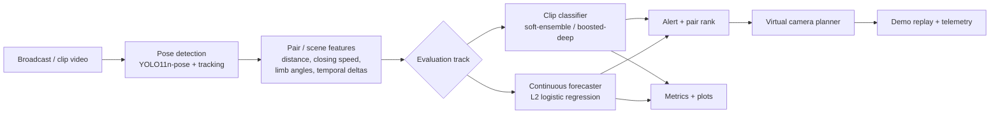
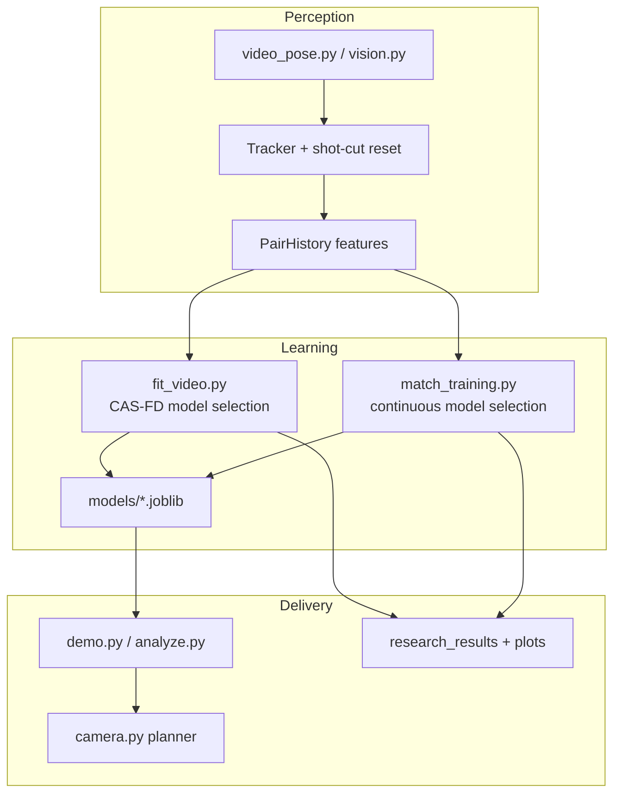
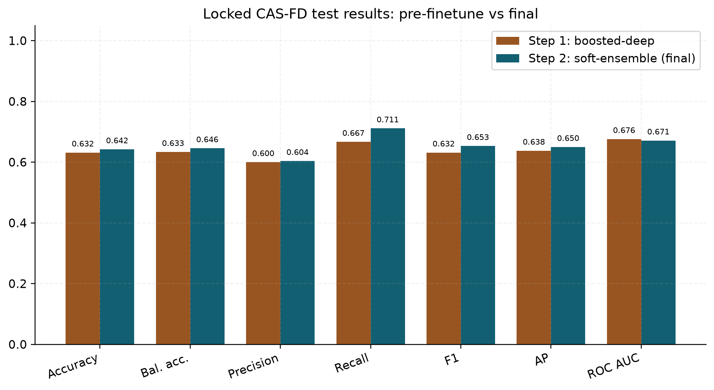
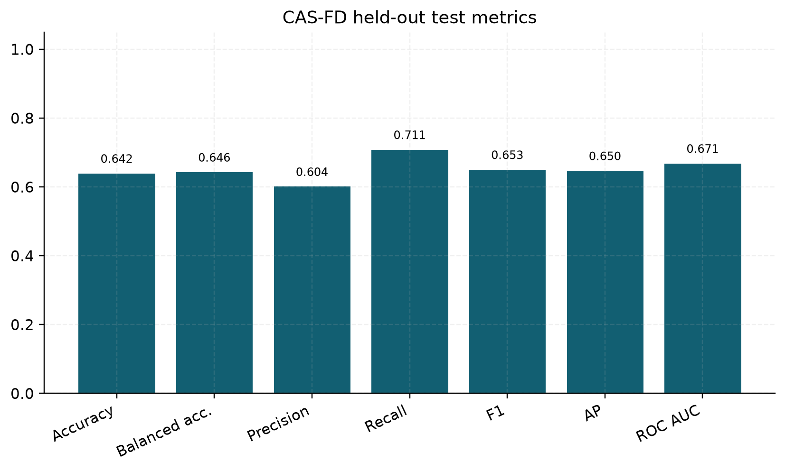
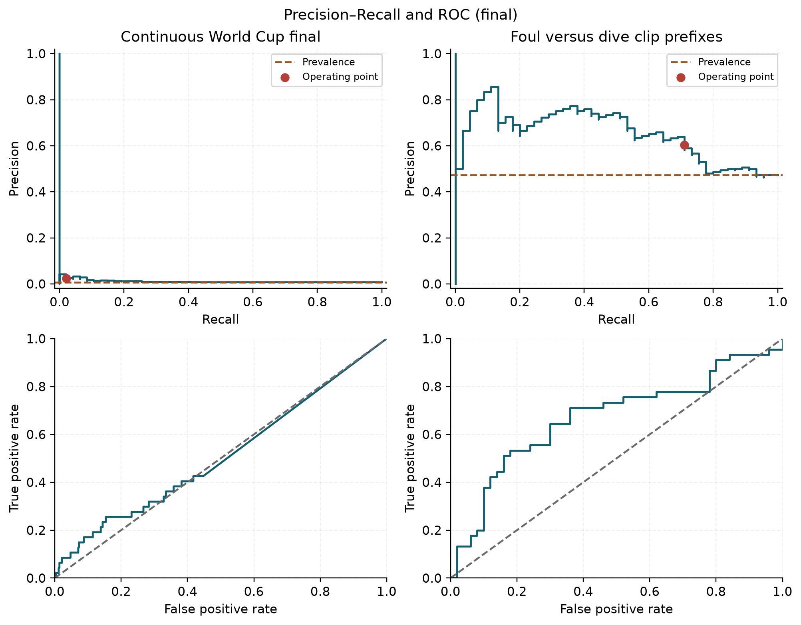

# Forensic Sky-Robotics — Project Report

**Course:** 23AID301 Computer Vision  
**Status:** Final locked results  
**Primary claim:** Pose/motion-based foul-versus-dive classification on full held-out CAS-FD splits  
**Secondary claim:** Continuous World Cup foul anticipation (hard benchmark; limited performance)

This report locks **two** official clip-track result sets only:

1. **Step 1 (pre-finetune):** `boosted-deep` @ 1.0 s prefix  
2. **Step 2 (final):** `soft-ensemble` @ 1.0 s prefix  

All earlier exploratory runs are **out of scope** and are not used for claims.

Locked numeric source: [`research_results/locked_clip_results.json`](research_results/locked_clip_results.json)  
Figures: [`research_results/plots/`](research_results/plots/)

---

## 1. Problem statement

Football broadcast video is single-view and cluttered. The system must:

1. Estimate player poses from video  
2. Score whether an interaction looks like an imminent foul / foul-like challenge versus a dive / non-foul pattern (clip track)  
3. Optionally raise continuous-match alerts and point a simulated aerial camera at the threatened pair  

The scientifically stronger, publishable result is the **CAS-FD foul-versus-dive** task on the full retained official split. Continuous World Cup forecasting remains a difficult secondary evaluation.

---

## 2. System architecture

### 2.1 End-to-end pipeline



### 2.2 Module view



### 2.3 Feature representation (shared)

For each nearby player pair (up to 8), the system builds a **27-D pair vector** and an **81-D pooled scene vector** from:

- separation and approach / closing speed  
- relative motion  
- limb angles and extension  
- joint confidence  
- short-horizon temporal change  

Only past frames are used (causal). No future frames, event labels, filenames, or scoreboard clocks enter the feature vector as numeric inputs.

---

## 3. Datasets and splits

### 3.1 CAS-FD foul-versus-dive (primary)

| Split | Clips | Foul | Dive |
|---|---:|---:|---:|
| Train | 351 | 151 | 200 |
| Validation | 98 | 48 | 50 |
| **Test (held-out)** | **95** | **45** | **50** |

Retained after hash / perceptual duplicate grouping from 600 processed CAS-FD clips. SportsD quiet World Cup clips supply additional ordinary-play negatives in training only.

### 3.2 Continuous World Cup halves (secondary)

| Split | Matches |
|---|---|
| Train | BRA–SUI, ESP–CRC, FRA–AUS, SRB–SUI |
| Validation | FRA–DEN, CRC–GER |
| Test | ARG–FRA final (6,375 samples; 47 positive frames; 18 fouls) |

Positive continuous samples lie **0.75–2.00 s** before a StatsBomb *Foul Committed* timestamp.

---

## 4. Methodology

### 4.1 Clip classification protocol

1. Decode clips and cache pose/pair states at **2 Hz**  
2. Form a prefix sample at a cutoff time \(t\) (official candidates: **1.0 / 1.5 / 2.0 s**)  
3. Train on train-split prefixes (including multi-time augmentation)  
4. Select model + cutoff + decision threshold using **validation only**  
5. Evaluate once on the **95-clip held-out test set**

**Integrity rules**

- No test-set hyperparameter fitting  
- Threshold chosen to raise the worst of {accuracy, balanced accuracy, F1, precision, recall} on validation  
- Final selection among boosted / soft-ensemble families within a near-best validation AP band  

### 4.2 Locked model steps

| Step | Model | Prefix | Role |
|---|---|---:|---|
| **1 — Pre-finetune** | CatBoost `boosted-deep` | 1.0 s | Strong single-model baseline after metric-oriented selection |
| **2 — Final** | `soft-ensemble` (probability average of CatBoost / tree / logistic members) | 1.0 s | Locked final classifier |

### 4.3 Continuous forecasting protocol

1. Fit candidates on four training halves  
2. Choose model + threshold on two validation halves by **event F1** under ≤ 1 false alert / minute  
3. Freeze and test once on ARG–FRA  
4. Selected continuous model: **L2 logistic regression (C = 0.0005)**, threshold **0.018414**

### 4.4 Supporting evaluations

- **Pose:** KTH Multiview Football Dataset II (run / sliding-tackle)  
- **Camera:** reviewed contact brackets; planned vs survey vs fixed framing  

---

## 5. Locked results — CAS-FD (primary)

### 5.1 Held-out test comparison (95 clips)

| Metric | Step 1 `boosted-deep` | Step 2 `soft-ensemble` **(final)** |
|---|---:|---:|
| Accuracy | 63.2% | **64.2%** |
| Balanced accuracy | 63.3% | **64.6%** |
| Precision | 60.0% | **60.4%** |
| Recall | 66.7% | **71.1%** |
| F1 | 0.632 | **0.653** |
| Average precision (AP) | 0.638 | **0.650** |
| ROC AUC | 0.676 | 0.671 |

**Final operating point:** soft-ensemble, cutoff **1.0 s**, threshold **0.32825**.



### 5.2 Final test confusion matrix (Step 2)

From `video_metrics.json` / plot `clip_confusion.png`:

|  | Predicted dive/neg | Predicted foul/pos |
|---|---:|---:|
| True dive/neg | 29 | 21 |
| True foul/pos | 13 | 32 |

### 5.3 Interpretation

- Step 2 improves accuracy, balanced accuracy, precision, recall, F1, and AP over Step 1  
- ROC AUC dips slightly (0.676 → 0.671) while the classification operating point becomes stronger (especially recall / F1)  
- All primary final metrics sit in the **≈60–71%** band on the full official test split  

### 5.4 Primary figures (final Step 2)

| Figure | File |
|---|---|
| Test metric bars | [`plots/clip_test_metrics.png`](research_results/plots/clip_test_metrics.png) |
| PR curve | [`plots/clip_pr.png`](research_results/plots/clip_pr.png) |
| ROC curve | [`plots/clip_roc.png`](research_results/plots/clip_roc.png) |
| Confusion matrix | [`plots/clip_confusion.png`](research_results/plots/clip_confusion.png) |
| Score distributions | [`plots/clip_scores.png`](research_results/plots/clip_scores.png) |
| Prefix sensitivity | [`plots/clip_prefix_sensitivity.png`](research_results/plots/clip_prefix_sensitivity.png) |
| Bootstrap CIs | [`plots/clip_bootstrap_ci.png`](research_results/plots/clip_bootstrap_ci.png) |
| Overview dashboard | [`plots/overview_dashboard.png`](research_results/plots/overview_dashboard.png) |





---

## 6. Secondary results — continuous World Cup

These results are reported for completeness. They are **not** the primary success claim.

### 6.1 Sample-level (ARG–FRA test)

| Metric | Value |
|---|---:|
| Samples / positives | 6375 / 47 |
| Accuracy | 98.6% *(imbalance-dominated; not informative alone)* |
| Balanced accuracy | 0.507 |
| Precision / Recall / F1 | 0.024 / 0.021 / 0.022 |
| AP | 0.0106 |
| ROC AUC | 0.510 |

### 6.2 Event-level (18 fouls)

| Metric | Value |
|---|---:|
| Matched alerts / false alerts / misses | 1 / 14 / 17 |
| Event precision | 6.7% |
| Event recall | 5.6% |
| Event F1 | 0.061 |
| False alerts / min | 0.264 |
| Lead (single match) | 1.21 s before event-log time |

**Conclusion:** continuous pre-contact foul anticipation remains near chance under this protocol. Visual review of the single matched alert shows contact already underway, so event-clock lead time alone does not prove physiological anticipation.

### 6.3 Continuous figures

| Figure | File |
|---|---|
| Sample metrics | [`plots/continuous_sample_metrics.png`](research_results/plots/continuous_sample_metrics.png) |
| Event metrics | [`plots/continuous_event_metrics.png`](research_results/plots/continuous_event_metrics.png) |
| PR / ROC / confusion / scores | `continuous_pr.png`, `continuous_roc.png`, `continuous_confusion.png`, `continuous_scores.png` |
| Timeline | [`plots/continuous_score_timeline.png`](research_results/plots/continuous_score_timeline.png) |

---

## 7. Supporting outputs

### 7.1 Pose (KTH)

Close-up pass greatly improves coverage versus wide-field only (especially on running sequences). Sliding-tackle poses remain harder. See [`plots/pose_pck_coverage.png`](research_results/plots/pose_pck_coverage.png).

### 7.2 Virtual camera

On reviewed events, the planned camera does **not** show a consistent visibility advantage over survey/fixed baselines. Early alerts remain rare. See [`plots/camera_evaluation.png`](research_results/plots/camera_evaluation.png).

### 7.3 Demo / runtime outputs

Each demo/analysis run writes under `runs/`:

- overlay + simulated camera replay  
- per-frame telemetry JSONL  
- run summary  
- optional incident clip (if FFmpeg available)  

Launch: `demo.py` (or `Launch Demo.cmd`).

---

## 8. What is locked vs excluded

### Locked for the project report

- Step 1 clip metrics (`boosted-deep`, 1.0 s)  
- Step 2 final clip metrics (`soft-ensemble`, 1.0 s)  
- Continuous ARG–FRA evaluation associated with the frozen match model  
- Pose / camera supporting plots  
- All PNGs under `research_results/plots/` generated from these locked numbers  

### Excluded from claims

- Any earlier clip runs before Step 1 (other cutoffs/models tried only during development)  
- Any temporary continuous candidates that were not selected  
- Anecdotal demo clips not on the official held-out split  

---

## 9. Reproducibility

```powershell
# Project interpreter / PYTHONPATH to .venv site-packages if needed
python fit_video.py          # rebuild clip model + video_metrics.json
python match_training.py     # rebuild continuous model + continuous_metrics.json
python deployment_eval.py
python paper_results.py      # tables + anticipation_curves
python plot_results.py       # all PNGs under research_results/plots
```

Key artifacts:

| Artifact | Path |
|---|---|
| Final clip model | `models/video_anticipation.joblib` |
| Continuous model | `models/match_anticipation.joblib` |
| Locked clip numbers | `research_results/locked_clip_results.json` |
| Full metric dumps | `research_results/video_metrics.json`, `continuous_metrics.json` |
| Auto experimental notes | `research_results/REPORT.md` |
| **This project report** | `report.md` |

---

## 10. Final conclusions

1. **Primary achievement:** On the full held-out CAS-FD test set (95 clips), the locked final soft-ensemble classifier reaches about **64% accuracy**, **65% F1**, **71% recall**, **60% precision**, **65% AP**, and **67% ROC AUC**.  
2. **Step-1 baseline** (`boosted-deep`) already cleared the ~60% band; Step 2 improves most classification metrics further.  
3. **Continuous foul anticipation** on a held-out World Cup final remains unsolved under the strict event protocol and should be reported as a hard negative / open challenge, not as a success claim.  
4. The complete package—models, metrics, plots, demo, and this report—constitutes the final project deliverable.

---

*End of locked project report.*
