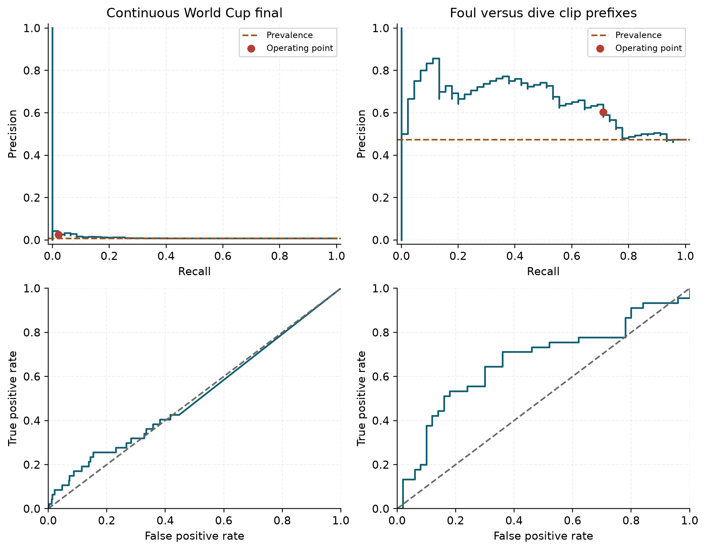

# Forensic Sky-Robotics | Experimental results

The pipeline estimates player poses, scores approaching interactions, and moves a simulated camera. In a held-out World Cup half, one of 15 alerts fell within the specified window before a logged foul. Visual inspection of that alert shows player contact already in progress. Reliable anticipation of first physical contact and improved officiating remain unproven.

## Continuous World Cup foul forecasting

Each sample uses only video available at that instant. A positive sample falls 0.75–2.00 seconds before a StatsBomb Foul Committed timestamp. A threshold crossing can match one event. The alarm rearms after a below-threshold observation and has a two-second refractory interval. Time gaps and detected shot changes reset state. Pre-match programming, halftime and unmatched clock intervals are excluded. Stoppages, replay shots embedded in the aligned broadcast and frames with insufficient player pairs remain in the evaluation.

| Match | Split | Sample minutes | Fouls | Positive / total samples | Samples with a pair |
|---|---|---:|---:|---:|---:|
| BRA_SUI | train | 50.91 | 16 | 39 / 6109 | 46.8% |
| ESP_CRC | train | 52.73 | 12 | 28 / 6328 | 68.4% |
| FRA_AUS | train | 52.23 | 15 | 36 / 6267 | 67.0% |
| SRB_SUI | train | 55.32 | 24 | 66 / 6638 | 67.7% |
| FRA_DEN | val | 49.94 | 6 | 17 / 5993 | 62.9% |
| CRC_GER | val | 55.04 | 6 | 13 / 6605 | 70.0% |
| ARG_FRA | test | 53.12 | 18 | 47 / 6375 | 44.7% |

Four matches trained the continuous model. Two separate matches selected the model and threshold by event F1 under a ceiling of one false alert per minute, breaking ties by average precision. The Argentina–France final supplied the test half. All seven matches are absent from the 39-match SportsD collection. All 97 recorded second-half fouls have an eligible observation window in these broadcasts.

| Validation candidate | Average precision | Event F1 | False alerts/min |
|---|---:|---:|---:|
| L2-0.0005 | 0.0115 | 0.0769 | 0.362 |
| L2-0.005 | 0.0040 | 0.0220 | 0.743 |
| L2-0.05 | 0.0026 | 0.0000 | 0.000 |
| L2-0.2 | 0.0024 | 0.0000 | 0.000 |
| Boost-3 | 0.0036 | 0.0000 | 0.000 |
| Boost-5 | 0.0036 | 0.0000 | 0.000 |
| clip-transfer | 0.0039 | 0.0220 | 0.743 |
| causal-temporal-CNN | 0.0034 | 0.0000 | 0.000 |

The selected model uses standardized pose and motion features with L2-regularized logistic regression (C = 0.0005). Its frozen threshold is 0.018414.

| Final event metric | Result |
|---|---:|
| Matched alerts / false alerts / missed events | 1 / 14 / 17 |
| Precision (exact binomial 95% interval) | 0.067 (0.002–0.319) |
| Recall (exact binomial 95% interval) | 0.056 (0.001–0.273) |
| F1 | 0.061 |
| False alerts per sample-minute | 0.264 |
| Lead against event clock, one matched alert | 1.214 s |

Confidence intervals for the alert counts are descriptive and assume independent trials. The sample-level intervals below resample one-minute blocks within the final. Neither interval measures uncertainty across future matches.

| Sample metric | Continuous final | Supplementary clip model |
|---|---:|---:|
| Samples | 6375 | 95 |
| Positive samples | 47 | 45 |
| Average precision | 0.0106 | 0.6498 |
| ROC AUC | 0.5101 | 0.6711 |
| Precision | 0.0238 | 0.6038 |
| Recall | 0.0213 | 0.7111 |
| F1 | 0.0225 | 0.6531 |
| Accuracy | 0.9864 | 0.6421 |
| Balanced accuracy | 0.5074 | 0.6456 |
| Brier score | 0.0073 | 0.2421 |
| Specificity | 0.9935 | 0.5800 |
| Matthews correlation | 0.0156 | 0.2927 |
| Positive prevalence / constant-score AP | 0.0074 | 0.4737 |

Final confusion counts (TN, FP, FN, TP) are [6287, 41, 46, 1]. Always predicting ordinary play yields 99.26% accuracy and zero foul recall. The 95% block-bootstrap intervals are 0.0053–0.0281 for average precision and 0.404–0.622 for ROC AUC.

The closing-speed and proximity baseline had test AP 0.0071 and matched no events, with 23 false alarms. Shifting the reference times by −1, −0.5, 0, +0.5 and +1 second yields respectively 0, 0, 1, 1 and 0 matched events. The single nominal hit occurs at video time 2491.0 s, during an ongoing challenge. The event-clock result alone cannot establish physiological or refereeing lead time.

## Short clips and dataset coverage

All 1,326 clips were decoded, processed at 2 Hz and scored with the deployed model (20,303 sampled frames, 163.3 minutes). SportsD supplies 726 World Cup on-ball decision clips. Its training split supplied background examples sufficiently distant from a recorded foul. CAS-FD supplies 600 foul/dive clips. Exact hashes and four-frame perceptual comparisons identified repeated footage. After grouping there were 351 training, 98 validation and 95 test clips. Source match identity is unavailable for CAS-FD, so additional same-match or alternative-angle overlap remains possible.

CAS-FD supplies clip labels only. For its auxiliary benchmark the model sees frames up to 1.0 s into the clip (≥1 s candidates). soft-ensemble won on validation AP among the expanded model grid. Test accuracy 64.2%, balanced accuracy 64.6%, precision 60.4%, recall 71.1%, F1 0.653, ROC AUC 0.671. The 95% clip-bootstrap AP interval was 0.502–0.807. The kinematic baseline AP was 0.457. In positive clips the later prefix outranked the 0.5 s prefix only 56.7% of the time, counting ties as one half.

The continuous model applied to these same held-out clip prefixes obtained AP 0.447 and recall 2.2%. On 24.8 minutes of held-out World Cup short clips distant from a logged foul it raised 62 alerts (2.50/min). Distant-event selection is a background proxy. Pooling those clips with the final would mix different sampling designs.

## Camera placement before contact

A visual audit marked coarse onset brackets and future contact locations in 21 retained foul clips and four clearly visible challenges in the final. These are single-observer, visibility-selected annotations. At the last observation at least 0.5 s before the lower onset bound, freeze each camera and test whether the later annotated point falls in view. An early alert lies at least 0.5 s before the lower bound and at most 3.5 s before the upper bound. Exclude intervening shot changes from geometric comparison. Framed-and-clear means the 3D sightline to the point avoids modeled player bodies. All three cameras start from the same pose. The survey camera follows the median player position.

| Source | Early alerts / reviewed | Comparable views | Planned framed and clear | Survey framed and clear | Fixed framed and clear |
|---|---:|---:|---:|---:|---:|
| CAS-FD | 1 / 21 | 21 | 17 | 17 | 20 |
| Final | 0 / 4 | 3 | 3 | 3 | 2 |

In the one early-alert clip, the predicted region was 6.2% of the normalized unit-square diagonal from the visually marked point. In the final audit all early-alert checks were negative. On the comparable final events the peak modeled speed and acceleration through the assessment times reached 7 and 4 scene units/s and scene units/s². The planned camera showed no consistent visibility advantage. Ground-plane geometry is approximate and ignores broadcast panning between frames. Camera outcomes are simulator measurements. Ground-truth offender/victim track IDs, physical camera paths, multi-view visibility and referee verdicts are unavailable for these events, so actor-ID precision, physical view IoU and decision fairness remain unmeasured.

## External football pose evaluation

KTH Multiview Football Dataset II supplies synchronized images, 2D labels, fitted 3D joints and orthographic cameras. The official reconstruction uses a unit cube. Errors below are expressed in torso lengths. An absolute error in millimetres would require a metric scale. The 12 common shoulder, elbow, wrist, hip, knee and ankle joints are evaluated on every image of both player-2 sequences. The pipeline matches the subject at box IoU ≥ 0.30. Coverage counts failures. PCK uses 20% of projected torso length and the all-image average counts missing bodies as zero. The 3D errors average over returned poses. MPJPE uses hip centering, camera coordinates and torso normalization. PA-MPJPE permits a similarity transform.

| Sequence | Pose input | Returned / images | All-image 2D PCK | Normalized MPJPE | Normalized PA-MPJPE |
|---|---|---:|---:|---:|---:|
| Run and sidestep | Wide-field proposals | 1 / 642 | 0.000 | 0.832 | 0.535 |
| Run and sidestep | Wide field + close-up | 613 / 642 | 0.771 | 0.329 | 0.203 |
| Run and sidestep | Annotated player box | 609 / 642 | 0.766 | 0.321 | 0.203 |
| Sliding tackle | Wide-field proposals | 20 / 690 | 0.007 | 0.814 | 0.502 |
| Sliding tackle | Wide field + close-up | 510 / 690 | 0.346 | 0.567 | 0.305 |
| Sliding tackle | Annotated player box | 547 / 690 | 0.354 | 0.629 | 0.333 |

The run-and-sidestep sequence exposed the original close-up failure and informed the rendering change. The sliding-tackle sequence was reserved as a follow-up check. Both feature the same player. These results quantify pose estimation on KTH imagery. The close-up display pass supplements the fitted wide-field forecasting input. The Qatar results above use the frozen forecasting pipeline.

## Data and reproducibility

The trained weights, original video manifests, event-clock anchors, sample-level predictions and per-event camera measurements are included in the project. The README lists the reproduction commands. Individual scores include validation and training rows clearly identified by their split. The model never receives future frames, event logs, camera annotations, filenames or scoreboards as numerical inputs. The original broadcast view itself can still correlate with an impending event.

Sources include [SportsD](https://huggingface.co/datasets/addisonwu05/sportsd), [CAS-FD](https://huggingface.co/datasets/jahid114593/foul-vs-dive-dataset), [StatsBomb Open Data](https://github.com/statsbomb/open-data), the [archived final](https://archive.org/details/argentina-vs-france-fifa-world-cup-2022-final), and the [KTH football benchmark](https://www.csc.kth.se/cvap/cvg/?page=footballdataset2). The other six full-broadcast URLs and checksums are in the [source manifest](../datasets/broadcast_halves/manifest.json). Cite Kazemi, Burenius, Azizpour and Sullivan, *Multi-view Body Part Recognition with Random Forests*, BMVC 2013, for KTH.
